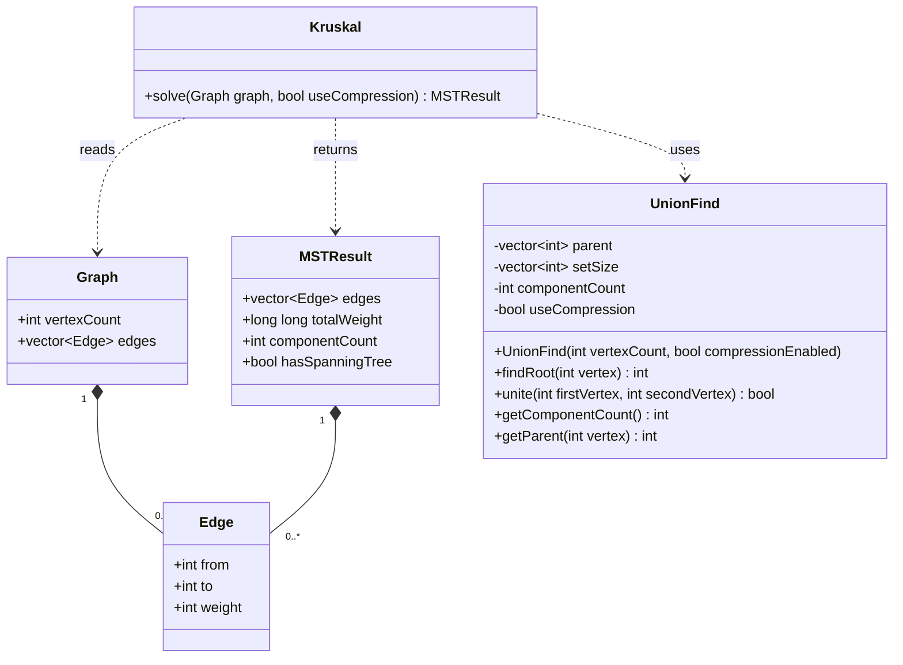

# DSA — Kruskal with Union-Find — Week 1

Phần lõi C++11 của đề tài cây khung nhỏ nhất. Chỉ gồm Union-Find, Kruskal,
console demo, dữ liệu ví dụ và một file kiểm tra đơn giản. Chưa có đồ họa,
benchmark hoặc vét cạn MST.

## Cấu trúc

```text
DSA/
├── src/
│   ├── Edge.h
│   ├── Graph.h
│   ├── MSTResult.h
│   ├── UnionFind.h
│   ├── UnionFind.cpp
│   ├── Kruskal.h
│   ├── Kruskal.cpp
│   └── main.cpp
├── examples/
│   ├── small_graph.txt
│   ├── disconnected_graph.txt
│   └── expected_results.txt
├── tests/
│   └── test.cpp
└── README.md
```

Các file `.h` khai báo dữ liệu/hàm. File `.cpp` chứa xử lý. `main.cpp` chỉ lo
nhập/xuất và gọi thuật toán; kiểm thử có `main()` riêng trong `tests/test.cpp`.
Không biên dịch hai file có `main()` vào cùng một chương trình.

## Biên dịch và chạy

### CLion

Mở thư mục `D:\DSA` dưới dạng CMake project bằng file `CMakeLists.txt`.
Nếu thư mục đang mở, chọn **Reload CMake Project** hoặc mở lại bằng file này.
Chọn target `DSA` để chạy chương trình, hoặc `DSA_tests` để chạy kiểm tra.
Sau khi chạy `DSA`, nhập đồ thị trong cửa sổ Run. Ví dụ:

```text
4 5
0 1 1
1 2 2
0 2 3
2 3 4
1 3 5
```

Nếu CMake báo không tìm được compiler, cấu hình Toolchain trong CLion với
g++ hiện có tại `C:\msys64\ucrt64\bin\g++.exe` (và công cụ build tương ứng).
File CMake cung cấp hai executable và một phần lõi dùng chung; kiểm thử không
được ghép vào executable chính nên không trùng hàm main.

### PowerShell

Mở PowerShell ở `D:\DSA`. Cần g++ hỗ trợ C++11 trong PATH.

```powershell
g++ -std=c++11 -O2 -Wall -Wextra -Wpedantic src/main.cpp src/UnionFind.cpp src/Kruskal.cpp -o main.exe
.\main.exe
```

Chạy bằng dữ liệu mẫu:

```powershell
Get-Content .\examples\small_graph.txt | .\main.exe
Get-Content .\examples\disconnected_graph.txt | .\main.exe
```

Nhập tay: chạy `main.exe`, nhập `V E`, tiếp theo E dòng `from to weight`.
Chương trình chính bật nén đường đi. File test kiểm tra riêng cả hai chế độ.
Đỉnh từ 0 tới V-1. V tối đa 1.000.000, E tối đa 2.000.000; trọng số là int.
Chương trình đọc đủ E cạnh; dữ liệu thừa phía sau không thuộc đồ thị được đọc.

Biên dịch và chạy kiểm tra riêng:

```powershell
g++ -std=c++11 -O2 -Wall -Wextra -Wpedantic -I src tests/test.cpp src/UnionFind.cpp src/Kruskal.cpp -o test.exe
.\test.exe
```

Kết quả đã xác nhận khi chuẩn bị gói: 8/8 kiểm tra, không có cảnh báo biên dịch.
Mẫu nhỏ chọn 0–1 (1), 1–2 (2), 2–3 (4), tổng 7. Đây là kiểm tra cơ bản;
kiểm chứng vét cạn và thử nghiệm lớn để tuần sau.

## Phân tích và thiết kế tuần 1

Đầu vào: đồ thị vô hướng có trọng số. Đầu ra: cạnh MST, tổng trọng số và trạng
thái liên thông. Nếu không liên thông thì thông báo không có MST và in rừng
khung nhỏ nhất. Một đỉnh có cây khung 0 cạnh; rỗng được quy ước không có cây khung.



Phác thảo bố cục giao diện tương lai (chưa triển khai):

```text
+-------------------------+----------------------------------+
| Số đỉnh, bảng cạnh       | Vùng vẽ đồ thị                   |
| [Run Kruskal] [Reset]    | Cạnh MST được làm nổi bật        |
+-------------------------+----------------------------------+
| Trạng thái | Danh sách cạnh MST | Tổng trọng số             |
+------------------------------------------------------------+
```

Giao diện sau này tạo Graph, gọi Kruskal::solve và hiển thị MSTResult;
không lấy mảng parent làm cạnh MST. Chưa chọn công nghệ giao diện.

## Giải thích phần lõi

- `Edge`, `Graph`, `MSTResult`: nhóm các dữ liệu liên quan; `vector` là mảng
  có thể thay đổi số phần tử. `push_back` thêm phần tử cuối mảng.
- `UnionFind`: mỗi đối tượng quản lý một phân hoạch đỉnh riêng. Constructor
  tạo parent[x]=x, mỗi nhóm một đỉnh. `private` bảo vệ dữ liệu; `public` là
  những hàm nơi khác được gọi.
- `findRoot`: đi theo cha tới gốc, sau đó cho các đỉnh trên đường đi trỏ thẳng
  về gốc nếu bật nén. Dùng vòng lặp, không đệ quy.
- `unite`: nếu cùng gốc thì trả false; nếu khác, nối nhóm nhỏ vào nhóm lớn,
  cập nhật kích thước và giảm số nhóm; trả true.
- `Kruskal::solve`: sao chép cạnh, sắp xếp theo trọng số tăng, chọn cạnh khi
  unite trả true, dừng khi đủ V-1 cạnh. Trả kết quả, không tự nhập hoặc in.
- `const Graph&`: nhận tham chiếu chỉ đọc, tránh sao chép cả đồ thị khi gọi.
- `std::` trong header giữ tên rõ ràng, không đưa `using namespace std` vào
  mọi file include nó. Các file `.cpp` vẫn dùng `using namespace std`.
- Constructor dùng `resize` để tạo mảng rồi gán từng giá trị bằng vòng lặp.
- Các vòng duyệt cạnh dùng chỉ số `index`; `selectedEdgeCount` đếm số cạnh
  đã chọn để dừng khi đủ V-1. Đổi hai gốc bằng biến tạm.
- UnionFind/Kruskal giả định dữ liệu hợp lệ; đường nhập console kiểm tra
  định dạng, giới hạn và chỉ số trước khi gọi thuật toán.

Khởi tạo O(V), tìm không nén với union-by-size xấu nhất O(log V). Có nén:
O(alpha(V)) khấu hao mỗi thao tác trên chuỗi. Kruskal có nén:
O(V + E log E + E alpha(V)), thường ghi O(E log E) với đồ thị liên thông.
Bộ nhớ O(V+E). Chưa đo benchmark nên chưa công bố mức tăng tốc thực nghiệm.

## AI hỗ trợ

AI hỗ trợ tạo/tách mã nguồn, thiết kế và kiểm tra gói này. Sinh viên cần tự
chạy lại, hiểu và ghi đóng góp thực tế khi nộp báo cáo/AI Usage Log.
